# WILD CROWN — Bộ ảnh duyệt trước implementation

**Current status: Map / UI / Character concepts approved by the user; player-facing text is now English-only.** The artwork and layout are preserved. Curated plates and overview sheets have been localized; original generated images/prompts remain historical provenance. This is concept approval, not a rig/runtime quality pass. No gameplay implementation or Tripo model generation is performed in this language update.

**Các nhận xét và ví dụ tiếng Việt bên dưới là biên bản review trước approval, không phải chuỗi dùng trong game hoặc yêu cầu duyệt lại.** English content authority: `../content/PLAYER-COPY.en.json` and `../content/GAME-NARRATIVE.en.md`.

## Xem nhanh ba bảng tổng hợp

1. [MAPS — Erya và First Pact](01-MAPS.jpg)
2. [UI — Exploration, Asha, Map/Journal, Companion](02-UI.jpg)
3. [CHARACTERS — Toàn bộ 15 nhân vật/form](03-CHARACTERS.jpg)

Mở ảnh riêng bên dưới để nhìn rõ mặt, anatomy, chữ và UI. Bảng tổng hợp chỉ để so sánh nhanh.

## 1. Map

| Ảnh | Nội dung | Nhận xét |
|---|---|---|
| [M01 — Erya](plates/M01.png) | 5 macro-region, Grove, Greenwake, Hollow dưới rễ | Đủ tốt để duyệt hướng geography/art: biome phân biệt, hub đọc rõ. Hollow đã được ghi rõ là dưới Grove. Chưa phải traversal graph hoặc seamless-world promise |
| [M02 — The First Pact](plates/M02.png) | 6 segment, main path, optional detours, camp/cage, bridge, arena depth, exit sau cleanse | Đường chính/nhánh và thứ tự kể chuyện rõ. Scale bar chỉ minh họa. Cổng sau cleanse hiện là đường tiến tới reunion, chưa là một shortcut quay về hub có reconnection cụ thể |

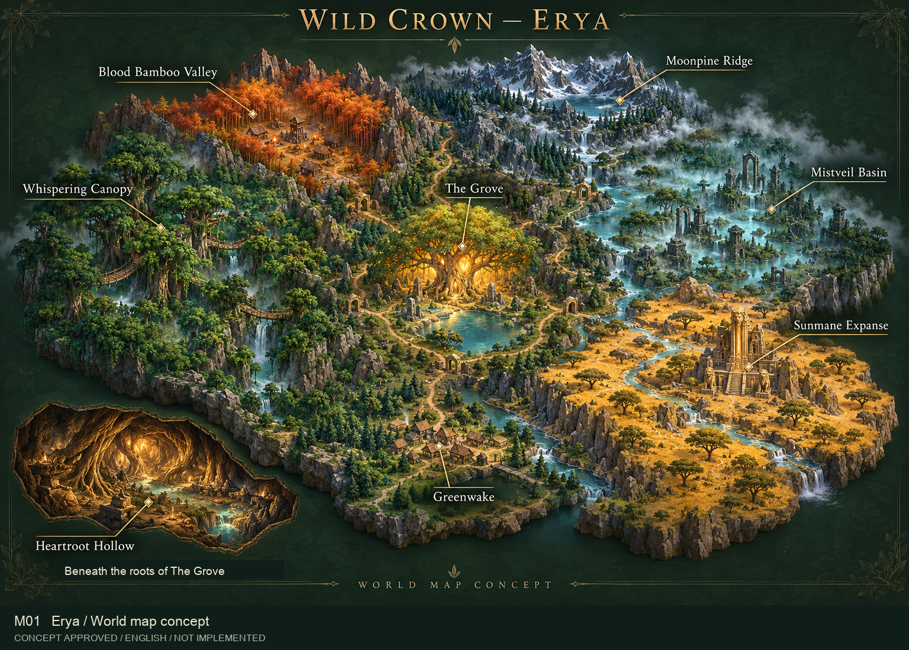

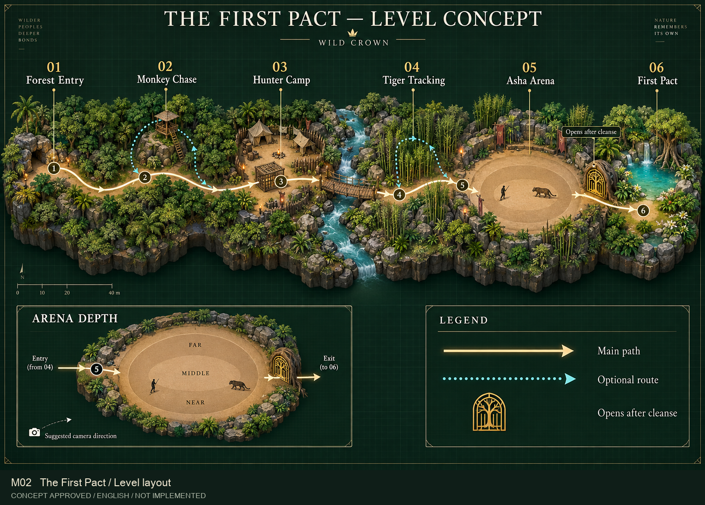

**Cần bạn quyết:** có giữ hướng thế giới/hub và cách bố trí First Pact này không? Duyệt ảnh không khóa các thông số meter, navmesh hoặc tốc độ di chuyển.

## 2. UI và camera trong ngữ cảnh

| Ảnh | Nội dung | Nhận xét |
|---|---|---|
| [U01 — Exploration](plates/U01.png) | Aren/Vara/Koro, thác/cầu, objective, vitality/dodge/Instinct | Hướng cảnh và route dễ hiểu, feet hiện rõ. Đã sửa quest thành Empty Orchard để tránh implied recruitment sai; HUD tách đúng ba loại thông tin |
| [U02 — Asha boss](plates/U02.png) | Staff phi sát thương, arena, pounce footprint, Ferocity/Corruption, Vara/Koro | Đã bỏ dagger sinh nhầm, giữ một gậy gỗ; Asha không nằm trong party HUD trước recruitment. Đã ghi rõ ba lõi chưa thanh lọc. Chưa là motion/telegraph quality proof |
| [U03 — Map/Journal](plates/U03.png) | Ash Hunters trước cứu Tali; route tới camp; late regions fogged | Đã sửa quest state: đang tìm trại, mở lồng là bước tiếp theo. Map không reveal Hollow. Cần typeset/localize hoàn chỉnh khi làm UI thật |
| [U04 — Companion](plates/U04.png) | Asha selected; Bond; abilities; đúng 3 party roles | Koro đúng primate, Vara đúng hornbill, không loot rarity. Top navigation đã thống nhất với U03 |

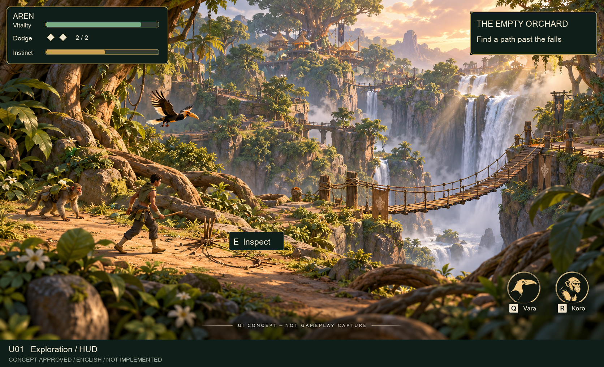

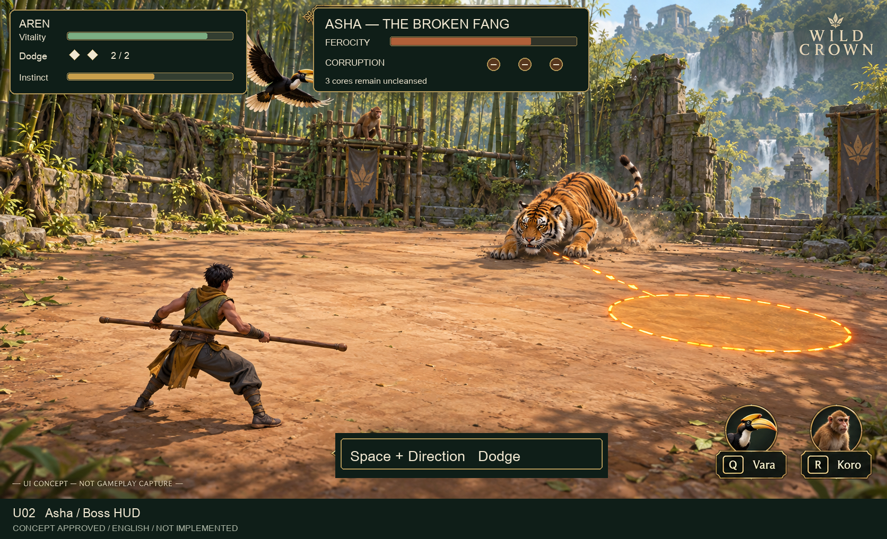

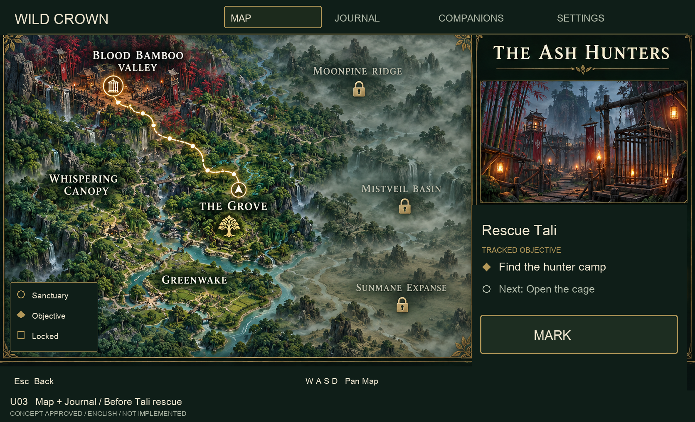

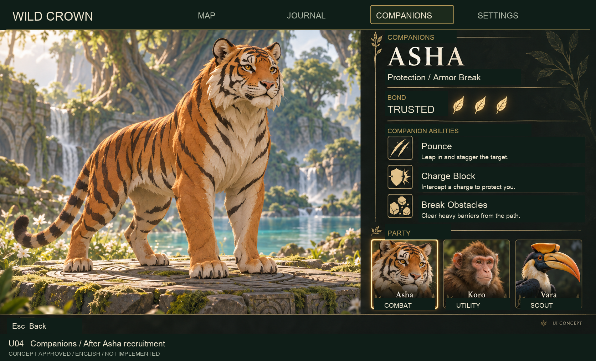

**Đánh giá thẳng:** đủ để chọn bố cục/palette/UI direction, chưa nên gọi UI final. Còn cần motion readability, kích thước chữ trên màn hình đích, controller focus, accessibility thực và dữ liệu nhiệm vụ thật. Asha boss illustration chưa thể hiện Black Sap trên cơ thể đủ mạnh để khóa corrupted variant; giữ effect/pose pass riêng sau khi duyệt identity.

## 3. Characters

### C01 — Aren, Yara, Orun, Marek

[Ảnh lớn C01](plates/C01.png)

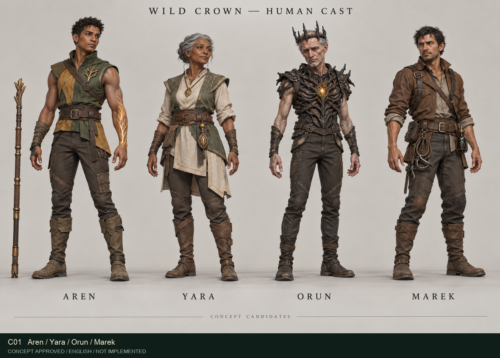

- **Aren:** silhouette/outfit moss–ochre, root mark tay trái và staff riêng đọc được; chưa giải thích cơ chế staff thu gọn.
- **Yara:** tuổi/mentor presence rõ; tà áo trước hông cần secondary pose/joint-clearance khi làm reference.
- **Orun:** đã sửa lỗi áo choàng dài, chân/quần tự do hơn. Six-tip crown/empty chest cần detail pass; tư thế đứng không chứng minh cartwheel rig.
- **Marek:** không caricature ác; posture/dụng cụ bẫy/Black Sap vial cần nhấn mạnh hơn nếu giữ hướng này.
- Human board vẫn thiên realistic về bề mặt da/vải hơn Koro/Tali: **chưa khóa thống nhất style toàn cast**.

### C02 — Vara, Koro, Asha, Tali

[Ảnh lớn C02](plates/C02.png)

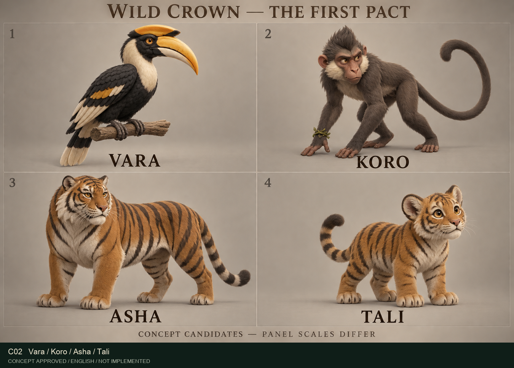

- Vara có casque/mỏ hornbill đúng loài; cần wing-spread/underside/perch feet views sau duyệt.
- Koro có crest, long arms và tail riêng, identity tốt; mắt/mặt cartoon hơn vài thú khác.
- Asha silhouette bảo hộ/shoulder/paws rõ; muzzle scar chưa đọc đủ rõ, lông vẫn nhiều detail.
- Tali khác tỷ lệ adult, không chỉ Asha scale nhỏ. Chốt mức dễ thương sao cho không lệch tone bi kịch.

### C03 — Ruun, Luma, Sable

[Ảnh lớn C03](plates/C03.png)

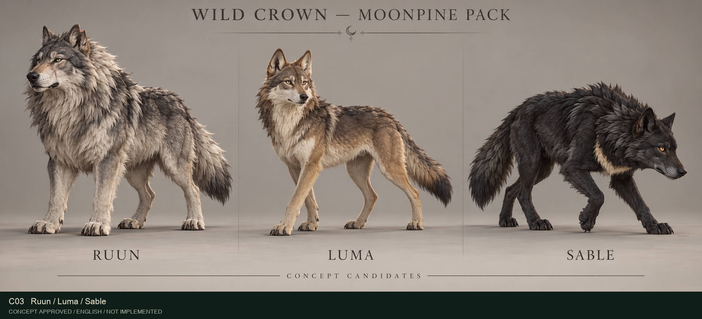

- Ruun nặng vai, già và kỷ luật; Luma thanh/alert; Sable đầu thấp tracking. Phân biệt đến từ posture/body, không chỉ màu.
- Fur còn dày/realistic hơn C02; Ruun ear scar chưa rõ.
- Sable đang bước với chân chồng nhau, không dùng trực tiếp làm neutral anatomical Tripo reference.

### C04 — Nyra, Solkar, Ghor (bản đã sửa)

[Ảnh lớn C04](plates/C04.png)

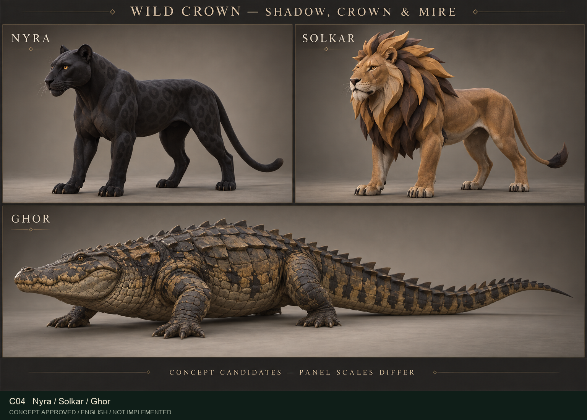

- Bản v1 bị quá photoreal và đuôi Ghor đọc như cụt; đã sinh v2 và xem trực tiếp.
- Nyra đứng rõ hơn; Solkar có mảng bờm lớn hình tia mặt trời; Ghor có đuôi hoàn chỉnh thu nhọn và scale/scutes đơn giản hơn.
- V2 là hướng **shape-first** rõ hơn, nên dùng để so sánh mức stylization với C01/C03. Rosettes Nyra còn khá nổi; có thể tiết chế theo roughness/ánh nghiêng khi khóa look.

### C05 — Crowned Beast

[Ảnh lớn C05](plates/C05.png)

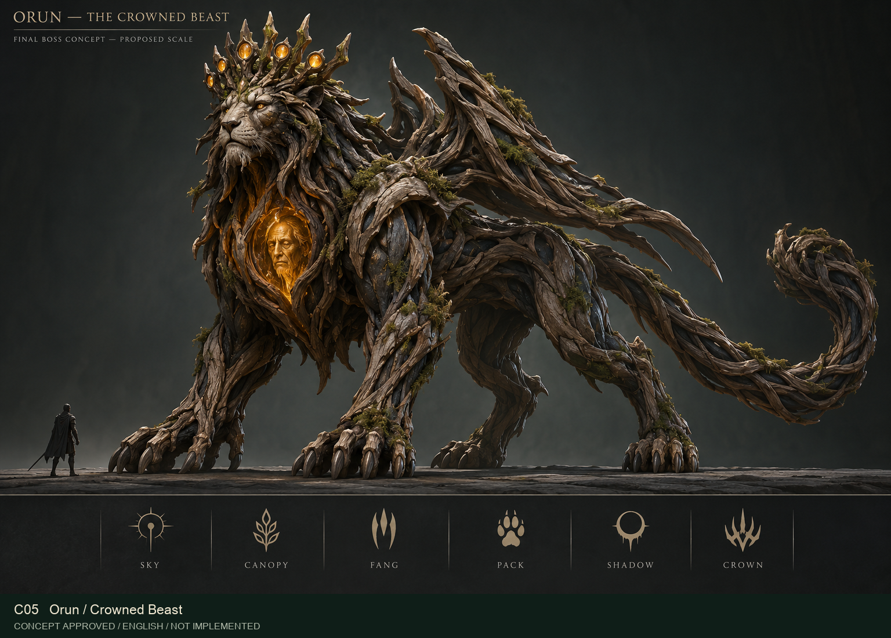

- Có silhouette boss riêng, lõi mặt Orun và vật liệu rễ/crown; không chỉ phóng to Orun người.
- **Chưa đề nghị duyệt final:** bark shards/spikes dày; form chủ yếu đọc lion/root. Sáu icon dưới ảnh chưa chứng minh sáu aspect đã có thiết kế chuyển động/biến thể rõ.
- Hình người nhỏ chỉ là scale silhouette vô danh, không thiết kế Aren. Scale đề xuất, chưa đo.
- Sau khi bạn chọn hướng boss: giản lược root hierarchy, khóa face likeness Orun, làm sáu state sheets theo attack aspect. Không cần thêm sáu đầu hoặc chồng mọi motif cùng lúc.

## 4. Những lỗi đã sửa trong lượt review

- Menu sinh nhầm Koro thành thú có sừng, Vara thành eagle: loại bản đó, sinh lại đúng loài.
- Aren bị sinh dao ở boss mockup: loại bản đó, sinh lại một staff gỗ phi sát thương.
- Quest rescue mang sai tên Mother’s Roar: đổi sang Ash Hunters trước cứu Tali.
- Generated HUD nhập nhằng dodge charges/Instinct: dàn lại bằng chữ/vectors cục bộ, giữ tách biệt vitality, hai charge và Instinct.
- HUD cũ còn lộ ngoài panel mới: mở rộng mask, kiểm lại compositing.
- Quest active/future step chưa phân biệt: dàn lại “Tìm trại săn” active và “Sau đó: Mở lồng giam”.
- Navigation map/companion khác thứ tự: thống nhất Bản đồ / Nhật ký / Đồng hành / Thiết lập.
- Ghor tail tip v1 không đạt: thay curated plate bằng v2, tail đầy đủ/thu nhọn.

Bản cũ giữ trong `images/` chỉ để provenance. **Chỉ dùng `plates/` và ba contact sheets làm bộ duyệt hiện tại.**

## 5. Kết luận: đã đủ tốt chưa?

| Nhóm | Cho duyệt hướng mỹ thuật | Cho production ngay |
|---|---|---|
| Map | Có, với caveat geography/scale/return shortcut | Chưa: cần playable layout/camera/nav evidence sau visual approval |
| UI | Có, đã sửa lỗi sai nội dung quan trọng | Chưa: interaction, state, contrast/size/accessibility phải đo ở runtime |
| C01/C02 | Có để chọn identity/outfit/species | Chưa: thống nhất style, detail marks và multi-view |
| C03/C04 | Có để chọn khác biệt loài/role; C04 v2 đơn giản hóa tốt hơn | Chưa: cân style giữa boards và neutral poses |
| C05 | Có để chọn hướng boss | Chưa: hierarchy, sáu aspect states, face và rig feasibility |

**Tôi không đề nghị bấm “duyệt tất cả rồi implement” chỉ vì ảnh đẹp.** Nên duyệt hoặc yêu cầu sửa từng nhóm. Model/rig production chỉ bắt đầu từ các character references đã được duyệt riêng.

## 6. Cách phản hồi nhanh

Bạn có thể dùng mã ảnh, ví dụ:

- `Map: giữ M01, M02 cần nhiều nhánh khám phá hơn.`
- `UI: giữ U03/U04; U01/U02 muốn HUD nhỏ hơn.`
- `Characters: giữ Aren/Yara/Koro/Tali; Asha muốn dữ hơn; áp mức stylized C04 cho sói; C05 bớt gai.`

Không cần xác nhận lại GLB Tripo, platform, tone phi sát thương hoặc historical Dominion. Không cần gửi key trong chat. Quyết định mới cần nhất là **hình nào giữ, hình nào sửa, và mức stylization chung**.

## 7. Evidence và giới hạn

- Đã xem từng ảnh; có hai nhánh review độc lập cho 6 map/UI plates và 5 character boards.
- Sau nhận review đã sửa local UI semantic/compositing và sinh lại C04; parent xem trực tiếp revision mới. Không tuyên bố reviewer đã duyệt revision chưa được họ xem.
- 11 PNG curated plates + 3 JPEG overview sheets được decode/verify; actual dimensions/encoding/hashes ở `IMAGE-MEASUREMENTS.json`.
- Prompt/provider/model ở `GENERATION-MANIFEST.json`; synthetic prompt-only generation, không gửi workspace reference images trong lượt này.
- Không live-call Tripo, không đo rigs, không run game, không pass Environment/Jev, không benchmark performance. Người dùng duyệt hình ảnh vẫn là gate độc lập.
